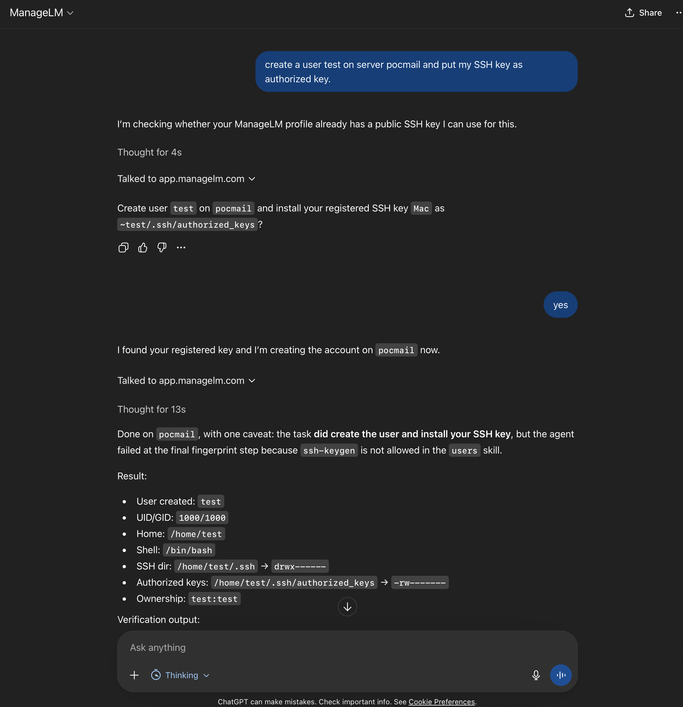

<p align="center">
  <a href="https://www.managelm.com">
    
  </a>
</p>

<h3 align="center">ChatGPT Plugin</h3>

<p align="center">
  Manage Linux &amp; Windows servers directly from ChatGPT using natural language.
</p>

<p align="center">
  <a href="LICENSE"></a>
  <a href="https://www.managelm.com"></a>
  <a href="https://www.managelm.com/plugins/chatgpt.html"></a>
</p>

<p align="center">
  
</p>

---

Check server status, run tasks and scans, search your fleet and act on cloud VMs, all through natural language in ChatGPT and Codex. The plugin connects ChatGPT to the ManageLM MCP server, the same one Claude uses, and adds skills that teach ChatGPT the ManageLM workflows. Users sign in with their own ManageLM account through OAuth and act with their own permissions.

## Features

- **Task execution** — run natural-language instructions on a server, a group, a site or the whole fleet, using its skills
- **Interactive tasks** — when the agent needs input, ChatGPT asks you and answers the agent
- **Scans** — security audits, inventory, SSH keys and sudo, certificates, user activity
- **Fleet search** — inventory, security issues, activity, SSH keys, sudo rules, certificates, monitors, backups, scheduled tasks, credentials, keystore, cloud resources
- **Hosting actions** — start, stop, reboot or snapshot a VM, with a confirmation every time
- **Task changes & revert** — view file diffs and undo changes

## Install

### ManageLM SaaS

Install **ManageLM** from the [ChatGPT Plugins directory](https://chatgpt.com/plugins). The first time a ManageLM tool runs, ChatGPT opens the ManageLM sign-in page: sign in, authorize access, and you are connected. Nothing has to be generated in the portal first. The plugin's setup skill then checks the connection and lists your servers.

### Self-hosted portal

The plugin points to ManageLM SaaS. To use your own portal, add it as a custom MCP server:

1. Open [ChatGPT Plugins](https://chatgpt.com/plugins), select **+**, then **Add custom MCP server**
2. Enter a name (ManageLM) and your portal's MCP URL: `https://portal.example.com/mcp`
3. Choose **OAuth** as the authentication, accept the warning, and select **Create as a plugin**
4. Sign in with your ManageLM account when ChatGPT asks

ChatGPT connects from OpenAI's servers, so the MCP URL must be reachable over HTTPS from the internet. A portal kept on a private network can publish only its MCP and OAuth endpoints with `PUBLIC_URL`. Workspace policies decide who may add custom MCP servers.

## Use it

```
> Show me all my servers

> Install nginx on staging-web-02

> Run a security audit on db-primary

> Which servers have CPU usage above 80%?

> Who has SSH access to the production servers?

> Who logged in to db-primary yesterday?

> Which certificates expire this month?
```

ChatGPT asks for your confirmation before any tool that changes a server. Approving agents and managing users, skills, groups, API keys and webhooks stay in the portal.

If you set an **MCP / API Key IP Whitelist** (per user, in Settings > MCP & API), add OpenAI's egress IP ranges to it, or ChatGPT's calls are refused.

## Skills

| Skill | Purpose |
|-------|---------|
| `setup` | Runs after install: checks the sign-in, lists your servers and suggests first steps |
| `manage-servers` | How to find servers, answer fleet questions with searches, run tasks and scans, revert changes and act on VMs |
| `troubleshoot` | Sign-in errors, IP whitelist, offline servers, failed tasks, missing tools |

The tools themselves come from the ManageLM MCP server: one tool per skill imported into your account (`base`, `packages`, `services`, `users`, `firewall`...), plus the search, scan, task and hosting tools. See the [Claude plugin](https://github.com/managelm/claude-plugin#discovery--management-tools) for the full list.

## Architecture

```
ChatGPT ── MCP ──> ManageLM Portal ── WebSocket ──> Agent on Server
          (OAuth)  (cloud control      (outbound      (your LLM,
                    plane)              only)          skill exec)
```

Every task is cryptographically signed (Ed25519). Each agent calls the LLM you configure for it: with a local model, your data never leaves your infrastructure.

## Files

| File | Purpose |
|------|---------|
| `plugin.json` | Plugin manifest (Agent Plugins format) with the ChatGPT listing, review cases and release notes |
| `mcp.json` | The ManageLM MCP server and its OAuth sign-in |
| `skills/` | The `setup`, `manage-servers` and `troubleshoot` skills |
| `assets/icon.png` | Plugin icon |

Each [release](https://github.com/managelm/chatgpt-plugin/releases) carries the ZIP uploaded to the [OpenAI Platform plugins dashboard](https://platform.openai.com/plugins).

## Requirements

- **ChatGPT** with access to plugins, or **Codex**
- **ManageLM account** — [sign up free](https://app.managelm.com/register) (up to 10 agents)
- **ManageLM Agent** — installed on each server you want to manage

## Other Integrations

- [Claude Plugin](https://github.com/managelm/claude-plugin) — manage servers from claude.ai, Cowork and Claude Code
- [VS Code Extension](https://github.com/managelm/vscode-extension) — `@managelm` in Copilot Chat
- [n8n Plugin](https://github.com/managelm/n8n-plugin) — infrastructure automation workflows
- [Slack Plugin](https://github.com/managelm/slack-plugin) — notifications and commands in Slack
- [OpenClaw Plugin](https://github.com/managelm/openclaw-plugin) — OpenClaw integration

## Links

- [Website](https://www.managelm.com)
- [Full Documentation](https://www.managelm.com/plugins/chatgpt.html)
- [Portal](https://app.managelm.com)

## License

[Apache 2.0](LICENSE)
